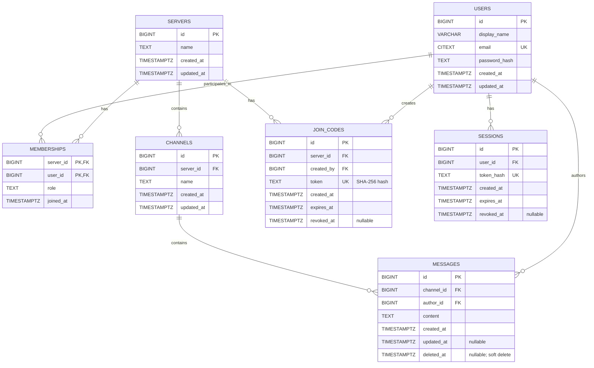

# RT Chat Database ER Diagram

This diagram reflects the current SQL migrations in `server/migrations/`.
Migration files are the source of truth for the schema.

## Relationships and constraints

- `memberships` is the many-to-many join between users and servers. Its
  composite primary key is `(server_id, user_id)`, so a user has at most one
  membership in a given server.
- Membership `role` is restricted to `member`, `admin`, or `owner`. A partial
  unique index on `memberships(server_id)` where `role = 'owner'` enforces at
  most one owner membership per server. Server creation inserts the server
  and its initial owner membership in one application transaction; the
  database constraint alone does not require an owner to exist.
- Channel names are not unique. Channel IDs are primary keys.
- `users.email` uses PostgreSQL `CITEXT` and is unique, making uniqueness
  case-insensitive.
- Join-code raw tokens are returned at creation, while the database stores
  their SHA-256 hashes in the unique `join_codes.token` column. A code also
  has expiration and optional revocation timestamps.
- Session raw tokens are placed in the `session_id` cookie; the database stores
  their SHA-256 hashes in the unique `sessions.token_hash` column.
- Messages use `deleted_at` for soft deletion. The active-message history
  index covers only rows where `deleted_at IS NULL`.

## Delete behavior

| Foreign key | Delete behavior |
| --- | --- |
| `memberships.server_id -> servers.id` | `ON DELETE CASCADE` |
| `memberships.user_id -> users.id` | `ON DELETE RESTRICT` |
| `channels.server_id -> servers.id` | `ON DELETE CASCADE` |
| `messages.channel_id -> channels.id` | `ON DELETE CASCADE` |
| `messages.author_id -> users.id` | `ON DELETE RESTRICT` |
| `join_codes.server_id -> servers.id` | `ON DELETE CASCADE` |
| `join_codes.created_by -> users.id` | `ON DELETE RESTRICT` |
| `sessions.user_id -> users.id` | `ON DELETE CASCADE` |

As a result, deleting a server cascades through its memberships, channels,
messages, and join codes. Deleting a user is restricted while dependent
membership, message, or join-code rows exist; sessions alone cascade. There is
currently no user-deletion API route.

## Index note

`messages_active_channel_history_idx` is a partial index on
`(channel_id, created_at DESC, id DESC)` for active messages. It supports the
message-history ordering and keyset pagination. Query-plan observations and
the tradeoff behind choosing a partial index are recorded in
[`database-performance-decisions.md`](database-performance-decisions.md).
