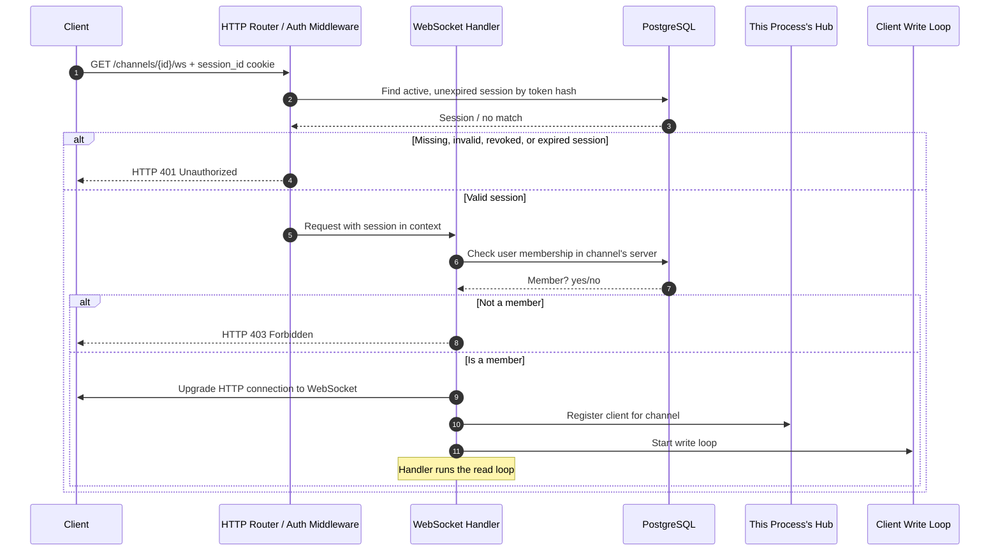
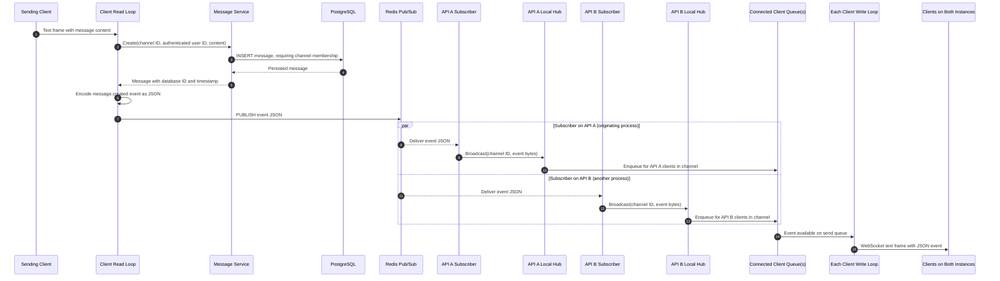
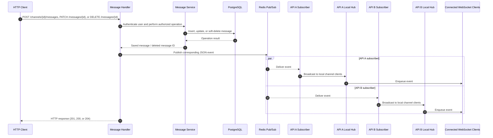

# RT Chat WebSocket Message Flow

This document describes the current implementation in
`server/internal/realtime/` and message events initiated by
`server/internal/messages/`. Each API process has an in-memory hub for its own
WebSocket connections; Redis Pub/Sub carries events between those process-local
hubs.

## 1. Connection and authorization



Authentication occurs before the WebSocket upgrade. Channel membership is
checked once, when the connection is opened. The current implementation does
not re-check membership if the user is removed while the connection remains
open.

## 2. Message sent over WebSocket

The client sends a WebSocket **text frame** containing the message content
itself, for example `Hello there`. The inbound frame is not a JSON request
object and there is no separate client message ID or command type.



### Ordering and event shape

The message is inserted before the event is published. Thus the event contains
the persisted message ID and timestamp, and a later history request can read
the message. The sending client receives the event through its API process's
Redis subscriber like other local clients; the publisher does not separately
broadcast to the local hub. There is no distinct acknowledgement protocol.

Creation event:

```json
{
  "type": "message.created",
  "channel_id": 31,
  "message": {
    "id": 101,
    "channel_id": 31,
    "content": "Hello there",
    "created_at": "2026-10-13T10:00:00Z",
    "author_id": 1
  }
}
```

The server currently has no structured WebSocket error event. If message
creation fails (for example, blank content), the failure is logged and the
read loop continues; no message event is published and no error response is
sent to the client. If creation succeeds but Redis publication fails, the
message remains in PostgreSQL, the failure is logged, and connected clients do
not receive that live event.

## 3. Message changed over HTTP

HTTP message create, edit, and delete handlers publish to Redis after the
service/repository operation succeeds. Each subscriber then broadcasts to its
process-local channel hub:



Events are:

- `message.created`: contains the full persisted message.
- `message.updated`: contains the updated message, including `updated_at`.
- `message.deleted`: contains `channel_id` and `message_id`; deletion is a
  soft delete in PostgreSQL.

The event is published before the handler writes the successful HTTP response.
The HTTP client may itself have a WebSocket connection and therefore receive
the event through its API process's Redis subscriber. If Redis publication
fails after the database operation succeeds, the handler logs the failure and
still returns the successful HTTP response; the persisted change remains
available through message history.

## 4. Disconnects and slow clients

Each client has a buffered outbound queue with capacity 16. The hub copies the
registered-client set while holding its read lock, then queues the event for
each client without holding that lock. This keeps network writes out of the
hub's critical section.

If a client's queue is full, enqueueing fails. The hub unregisters and closes
that client rather than allowing one slow connection to stall broadcasts to
the rest of the channel. A read error or write error also ends the connection;
cleanup unregisters the client and closes its socket. The client has one read
loop and one write loop, so concurrent hub broadcasts are serialized through
the outbound queue for each connection.

## Current boundaries

- Each hub exists only in its API process's memory. Redis Pub/Sub distributes
  events so connected clients on other API instances can receive them.
- Redis Pub/Sub is transient: it does not persist or replay events, and there
  is no delivery guarantee for disconnected subscribers. PostgreSQL remains
  the durable message source of truth.
- If publishing fails after a message write, the failure is logged but the
  database write is not rolled back. Connected clients can refresh history to
  observe the saved change.
- Membership is checked at connection time, not continuously during the
  connection.
- WebSocket writes are not persisted as a separate event stream; PostgreSQL
  messages are the durable record.
- There is no structured error/ack event, replay after reconnect, or delivery
  guarantee to a disconnected client. Clients can retrieve current history
  through `GET /channels/{id}/messages` after reconnecting.
- The current client protocol sends message text directly in a text frame;
  server-to-client events use JSON envelopes.

These are descriptions of current behavior, not a list of commitments about
future protocol design.
